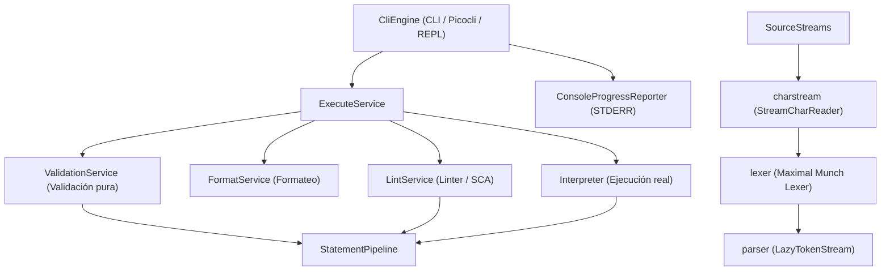

# Módulo `com.ingsis.engine`: Arquitectura, Componentes y Funcionamiento

El módulo [`com.ingsis.engine`](file:///home/elchurro274/Faculty/ingsis/PrintScript/com.ingsis.engine) es el **orquestador central y punto de entrada ejecutable** (*driver / CLI application*) del lenguaje PrintScript. Su objetivo fundamental es coordinar todos los módulos del compilador/intérprete en un pipeline unificado y desacoplado, exponiendo tanto una API programática tipada ([`Engine`](file:///home/elchurro274/Faculty/ingsis/PrintScript/com.ingsis.engine/src/main/java/engine/Engine.java)) como una interfaz de línea de comandos robusta ([`CliEngine`](file:///home/elchurro274/Faculty/ingsis/PrintScript/com.ingsis.engine/src/main/java/engine/CliEngine.java)) basada en **Picocli**.

---

## 1. Estructura y Componentes del Módulo

El módulo se compone de tres paquetes primordiales:

```
com.ingsis.engine/
└── src/main/java/
    ├── engine/
    │   ├── Engine.java               # Interfaz contractual de alto nivel
    │   ├── CliEngine.java            # Entry point ejecutable (Picocli), despacho y REPL
    │   ├── InputSupplier.java        # SAM interface para inyección de lectura (readInput)
    │   └── OutputEmitter.java        # SAM interface para inyección de salida (println)
    ├── service/
    │   ├── SourceStreams.java        # Construcción lazy del flujo: bytes → chars → tokens
    │   ├── ExecutionContext.java     # Contexto inmutable de ejecución (versión, I/O, streams)
    │   ├── ExecuteService.java       # Orquestador maestro y ejecutor del intérprete
    │   ├── ValidationService.java    # Validador sintáctico y semántico sin ejecución
    │   ├── FormatService.java        # Formateador de código fuente desde configuración YAML
    │   └── LintService.java          # Análisis estático de código (SCA) en streaming
    └── progress/
        ├── ProgressListener.java     # Interfaz de notificación de progreso de parseo
        ├── ProgressCharReader.java   # Decorador de CharReader que reporta bytes leídos
        └── ConsoleProgressReporter.java # Renderizador de barra de progreso en STDERR
```

---

## 2. Diagrama de Relaciones y Flujo de Control



---

## 3. ¿Qué contiene cada componente y cuál es su responsabilidad?

### 3.1. Paquete `engine`

1. **[`Engine.java`](file:///home/elchurro274/Faculty/ingsis/PrintScript/com.ingsis.engine/src/main/java/engine/Engine.java)**:
   - Define el contrato unificado del motor para clientes Java externos:
     - `validate(Version, InputStream)`: chequeo sintáctico y semántico estático.
     - `interpret(Version, OutputEmitter, InputSupplier, InputStream)`: ejecución completa.
     - `format(Version, InputStream, InputStream config, Writer)`: formateo de código.
     - `analyze(Version, InputStream, InputStream config)`: análisis estático de reglas.

2. **[`CliEngine.java`](file:///home/elchurro274/Faculty/ingsis/PrintScript/com.ingsis.engine/src/main/java/engine/CliEngine.java)**:
   - Implementa `Callable<Integer>` para Picocli y la interfaz `Engine`.
   - **Parámetros y Opciones**:
     - `operation`: Operación solicitada (`exec`/`interpret`, `validate`, `format`, `lint`/`sca`, o `repl`).
     - `-i, --input`: Archivo de entrada (o `System.in`).
     - `-c, --config`: Archivo de reglas YAML (opcional, para `format` y `sca`).
     - `-o, --output`: Archivo de salida (o `System.out`).
     - `-v, --version`: Versión de PrintScript (`1.0` o `1.1`).
     - `--no-progress`: Desactiva la barra de progreso en `STDERR`.
   - **REPL Interactivo**:
     - Si no se especifica archivo de entrada ni operación (`inputFile == null` y `System.in` interactivo), invoca `runRepl()`.
     - Mantiene un `ReplState` persistente que preserva tanto el [`SemanticEnvironment`](file:///home/elchurro274/Faculty/ingsis/PrintScript/com.ingsis.parser/src/main/java/semantic/environment/SemanticEnvironment.java) (variables declaradas, tipos, mutabilidad) como el [`Environment`](file:///home/elchurro274/Faculty/ingsis/PrintScript/com.ingsis.interpreter/src/main/java/environment/Environment.java) de runtime (valores en memoria) entre líneas consecutivas.

3. **[`InputSupplier.java`](file:///home/elchurro274/Faculty/ingsis/PrintScript/com.ingsis.engine/src/main/java/engine/InputSupplier.java)** y **[`OutputEmitter.java`](file:///home/elchurro274/Faculty/ingsis/PrintScript/com.ingsis.engine/src/main/java/engine/OutputEmitter.java)**:
   - Interfaces funcionales que desacoplan al motor de la consola estándar. Permiten redirigir la entrada (`readInput`) desde sockets, mocks o pipes, y la salida (`println`) a buffers de memoria, logs o interfaces gráficas.

---

### 3.2. Paquete `service`

1. **[`SourceStreams.java`](file:///home/elchurro274/Faculty/ingsis/PrintScript/com.ingsis.engine/src/main/java/service/SourceStreams.java)**:
   - Factoría estática responsable de construir la tubería perezosa (*lazy pipeline*):
     - Convierte el `InputStream` en un [`StreamCharReader`](file:///home/elchurro274/Faculty/ingsis/PrintScript/com.ingsis.charstream/src/main/java/charstream/StreamCharReader.java).
     - Si hay barra de progreso, lo envuelve en un [`ProgressCharReader`](file:///home/elchurro274/Faculty/ingsis/PrintScript/com.ingsis.engine/src/main/java/progress/ProgressCharReader.java).
     - Instancia [`CharStream`](file:///home/elchurro274/Faculty/ingsis/PrintScript/com.ingsis.charstream/src/main/java/charstream/CharStream.java), luego [`Lexer`](file:///home/elchurro274/Faculty/ingsis/PrintScript/com.ingsis.lexer/src/main/java/lexer/Lexer.java) y finalmente [`LazyTokenStream`](file:///home/elchurro274/Faculty/ingsis/PrintScript/com.ingsis.parser/src/main/java/tokenstream/LazyTokenStream.java).
   - **Garantía clave**: Nunca lee todo el archivo a un string ni carga todos los tokens de golpe.

2. **[`ValidationService.java`](file:///home/elchurro274/Faculty/ingsis/PrintScript/com.ingsis.engine/src/main/java/service/ValidationService.java)**:
   - Ejecuta un [`StatementPipeline`](file:///home/elchurro274/Faculty/ingsis/PrintScript/com.ingsis.parser/src/main/java/pipeline/StatementPipeline.java) con `StatementAction.NONE`.
   - Analiza la corrección léxica, sintáctica y semántica sentencia por sentencia.
   - Si no hay errores, retorna `CorrectResult("Validation successful...")`. Si ocurre un fallo léxico, sintáctico o semántico, retorna `IncorrectResult(mensaje)` con posición y línea.

3. **[`ExecuteService.java`](file:///home/elchurro274/Faculty/ingsis/PrintScript/com.ingsis.engine/src/main/java/service/ExecuteService.java)**:
   - Coordina la ejecución real del programa.
   - Configura el [`DefaultInterpreter`](file:///home/elchurro274/Faculty/ingsis/PrintScript/com.ingsis.interpreter/src/main/java/interpreter/DefaultInterpreter.java) proveyéndole:
     - El parser sintáctico correspondiente a la versión (`ParserFactory.createParser(version)`).
     - El [`SemanticChecker`](file:///home/elchurro274/Faculty/ingsis/PrintScript/com.ingsis.parser/src/main/java/semantic/SemanticChecker.java).
     - El `OutputEmitter` (impresión en consola).
     - El [`DefaultFunctionRegistry`](file:///home/elchurro274/Faculty/ingsis/PrintScript/com.ingsis.interpreter/src/main/java/builtin/DefaultFunctionRegistry.java) con proveedores inyectados para `readInput` (vía `InputSupplier`) y `readEnv` (vía `System::getenv`).

4. **[`FormatService.java`](file:///home/elchurro274/Faculty/ingsis/PrintScript/com.ingsis.engine/src/main/java/service/FormatService.java)**:
   - Carga el archivo de reglas YAML mediante [`YamlFormatRulesLoader`](file:///home/elchurro274/Faculty/ingsis/PrintScript/com.ingsis.formatter/src/main/java/formatter/config/YamlFormatRulesLoader.java) generando un [`FormatContext`](file:///home/elchurro274/Faculty/ingsis/PrintScript/com.ingsis.formatter/src/main/java/formatter/FormatContext.java).
   - Instancia [`TokenStreamFormatter`](file:///home/elchurro274/Faculty/ingsis/PrintScript/com.ingsis.formatter/src/main/java/formatter/TokenStreamFormatter.java) y formatea el código en streaming escribiendo directamente sobre el `Writer` de destino.

5. **[`LintService.java`](file:///home/elchurro274/Faculty/ingsis/PrintScript/com.ingsis.engine/src/main/java/service/LintService.java)**:
   - Carga las reglas de SCA con [`YamlScaRulesLoader`](file:///home/elchurro274/Faculty/ingsis/PrintScript/com.ingsis.sca/src/main/java/sca/config/YamlScaRulesLoader.java).
   - Utiliza [`StatementPipeline`](file:///home/elchurro274/Faculty/ingsis/PrintScript/com.ingsis.parser/src/main/java/pipeline/StatementPipeline.java) ejecutando el linter ([`ASTSca`](file:///home/elchurro274/Faculty/ingsis/PrintScript/com.ingsis.sca/src/main/java/sca/ASTSca.java)) a medida que cada sentencia es parseada.
   - **Eficiencia de memoria**: Mantiene únicamente en memoria la lista acumulada de violaciones detectadas, descartando los nodos del AST ya procesados.

---

### 3.3. Paquete `progress`

- **[`ProgressCharReader.java`](file:///home/elchurro274/Faculty/ingsis/PrintScript/com.ingsis.engine/src/main/java/progress/ProgressCharReader.java)**: Intercepta cada llamada a `read()` calculando bytes leídos sobre el total del archivo.
- **[`ConsoleProgressReporter.java`](file:///home/elchurro274/Faculty/ingsis/PrintScript/com.ingsis.engine/src/main/java/progress/ConsoleProgressReporter.java)**: Escribe una barra de progreso animada en `STDERR` (`[====>   ] 45%`), limpiándola de la pantalla antes de cualquier emisión en `STDOUT` para evitar colisiones visuales.

---

## 4. Códigos de Salida y Manejo de Errores

`CliEngine` estandariza los códigos de salida de proceso:
- **`0`**: Ejecución o validación exitosa, formateo completado, o análisis SCA sin violaciones.
- **`1`**: Error léxico, sintáctico, semántico, runtime exception o violaciones encontradas en análisis SCA.
- **`2`**: Error de invocación de CLI (argumentos inválidos, flags no reconocidos, archivo inexistente).
