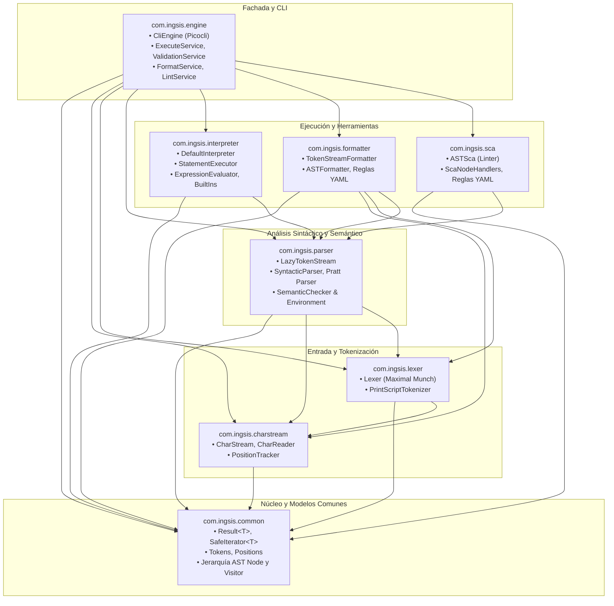
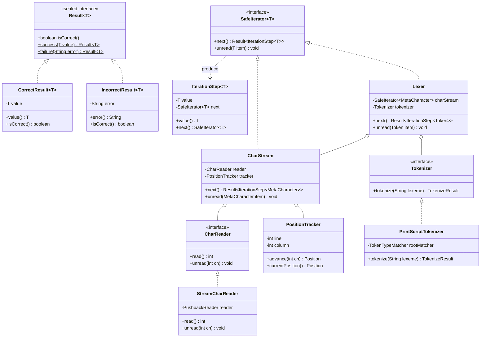
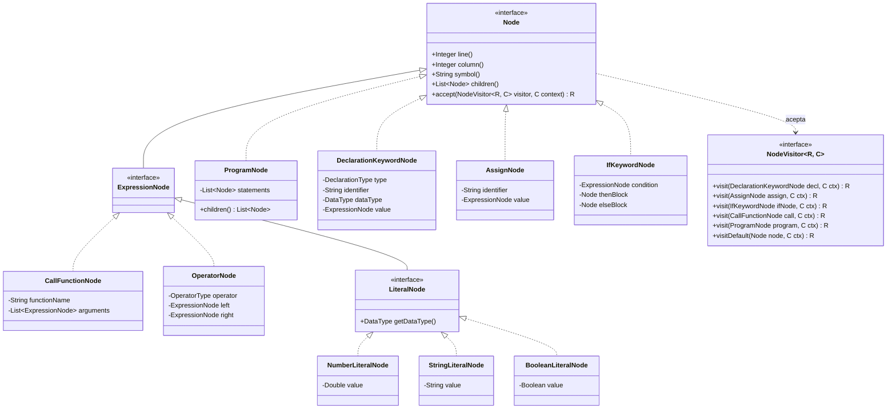
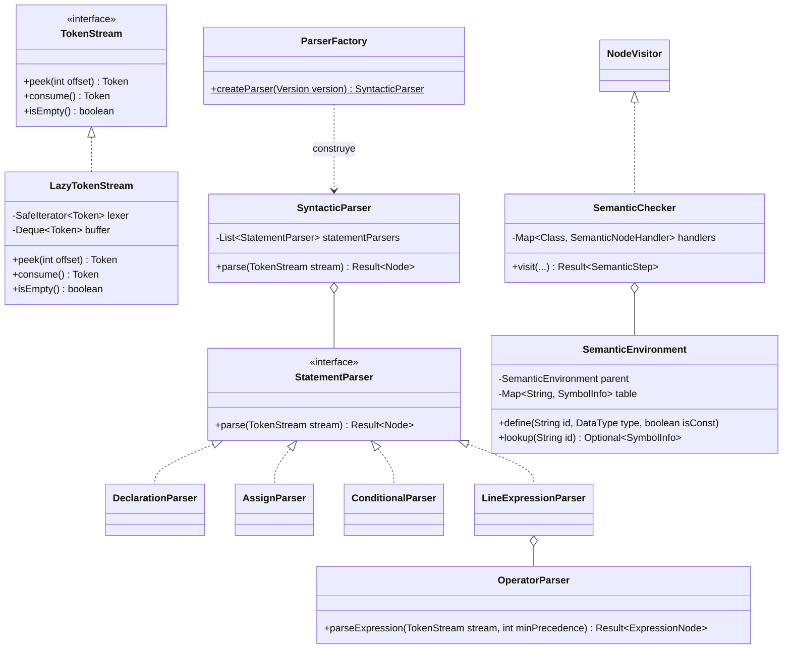
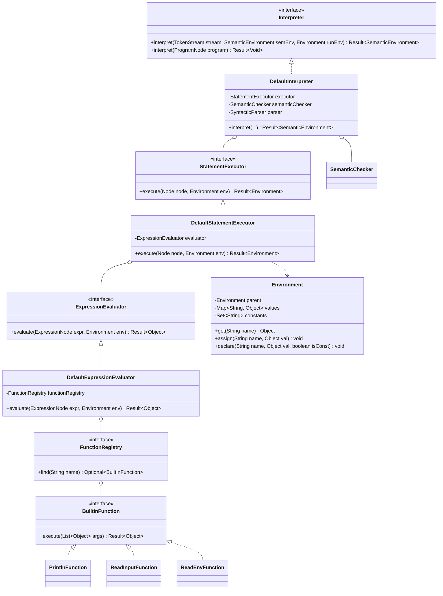
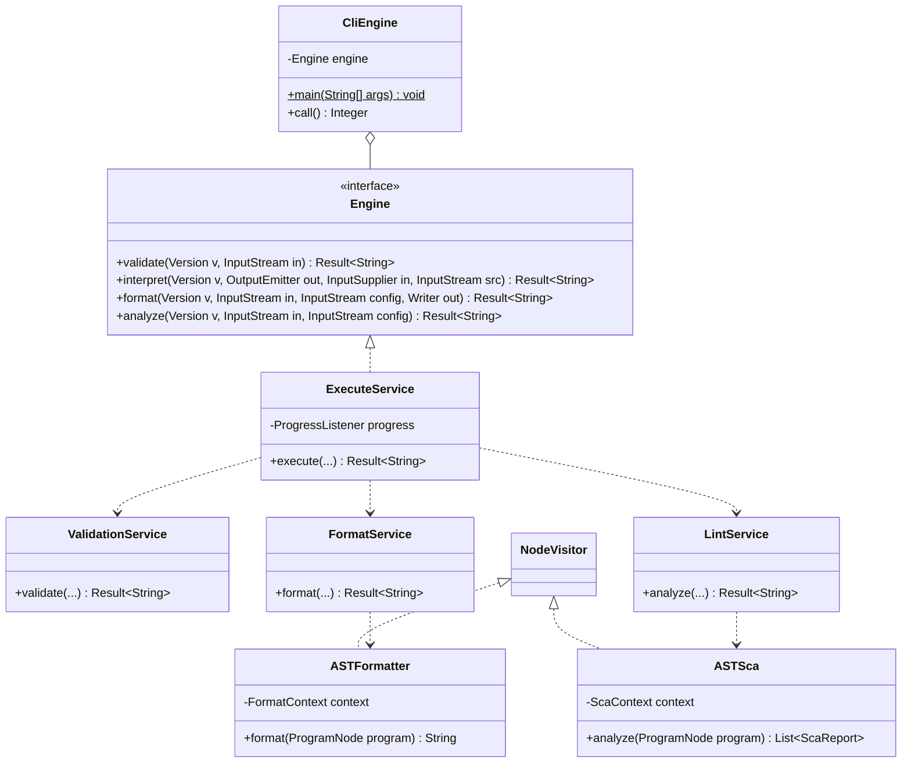
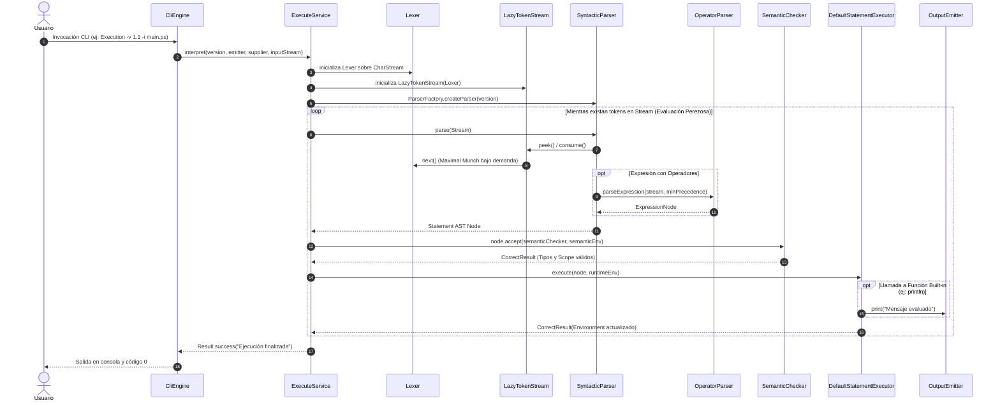

# Diagrama UML y Arquitectura del Sistema PrintScript

Este documento detalla la arquitectura integral de **PrintScript** mediante diagramas UML (en formato Mermaid) que cubren las diferentes capas del sistema, la descomposición modular, la jerarquía de clases, los patrones de diseño aplicados y la dinámica de ejecución.

---

## Tabla de Contenidos
1. [Vista Modular y Paquetes (Diagrama de Componentes)](#1-vista-modular-y-paquetes-diagrama-de-componentes)
2. [Capa Base y Streaming de Entrada (`common`, `charstream`, `lexer`)](#2-capa-base-y-streaming-de-entrada-common-charstream-lexer)
3. [Jerarquía AST y Patrón Visitor (`common.node`)](#3-jerarquía-ast-y-patrón-visitor-commonnode)
4. [Análisis Sintáctico y Semántico (`parser`)](#4-análisis-sintáctico-y-semántico-parser)
5. [Motor de Ejecución e Intérprete (`interpreter`)](#5-motor-de-ejecución-e-intérprete-interpreter)
6. [Fachada, Servicios y Herramientas (`engine`, `formatter`, `sca`)](#6-fachada-servicios-y-herramientas-engine-formatter-sca)
7. [Diagrama de Secuencia: Flujo de Ejecución de Sentencias](#7-diagrama-de-secuencia-flujo-de-ejecución-de-sentencias)
8. [Matriz de Patrones de Diseño Aplicados](#8-matriz-de-patrones-de-diseño-aplicados)

---

## 1. Vista Modular y Paquetes (Diagrama de Componentes)

El proyecto está descompuesto en 8 submódulos Gradle independientes, organizados para mantener un flujo de dependencias unidireccional y sin ciclos:

---

## 2. Capa Base y Streaming de Entrada (`common`, `charstream`, `lexer`)

Modela la mónada `Result<T>` para el manejo funcional de fallos, el streaming perezoso con memoria constante $O(1)$ a través de `SafeIterator<T>`, el rastreo espacial de coordenadas (`PositionTracker`) y el tokenizador basado en *Maximal Munch*.

---

## 3. Jerarquía AST y Patrón Visitor (`common.node`)

Define el Árbol de Sintaxis Abstracta inmutable mediante Java Records y la interfaz `NodeVisitor<R, C>` para operaciones externas desacopladas (semántica, formato, linteo).

---

## 4. Análisis Sintáctico y Semántico (`parser`)

Estructura el parsing compuesto de sentencias, el algoritmo **Pratt Parser** (`OperatorParser`) para expresiones aritmético-lógicas y el chequeo semántico de tipos y ámbitos (`SemanticChecker` y `SemanticEnvironment`).

---

## 5. Motor de Ejecución e Intérprete (`interpreter`)

Modela el runtime en memoria: despacho y ejecución de sentencias (`StatementExecutor`), evaluación de expresiones (`ExpressionEvaluator`), ámbito de variables (`Environment`) y registro de funciones nativas (`BuiltInFunction`).

---

## 6. Fachada, Servicios y Herramientas (`engine`, `formatter`, `sca`)

El módulo `engine` actúa como interfaz unificada (CLI mediante Picocli y servicios delegados). Además, se muestran las herramientas de formateo y análisis estático (`sca`).

---

## 7. Diagrama de Secuencia: Flujo de Ejecución de Sentencias

Representa la interacción paso a paso en tiempo de ejecución:

---

## 8. Matriz de Patrones de Diseño Aplicados

| Patrón de Diseño | Componentes Clave | Propósito Arquitectónico |
|---|---|---|
| **Result / Monad** | `result.Result<T>`, `CorrectResult`, `IncorrectResult` | Elimina el uso de excepciones (`throw`) para control de flujo, obligando al manejo exhaustivo de casos de error en tiempo de compilación. |
| **Iterator / Streaming** | `SafeIterator<T>`, `IterationStep<T>`, `CharStream`, `Lexer` | Lectura y tokenización perezosa bajo demanda con consumo de memoria constante $O(1)$. |
| **Maximal Munch** | `Lexer`, `PrintScriptTokenizer` | Resolución determinista de tokens con prefijos compartidos (`=` vs `==`, `let` vs identificadores). |
| **Pratt Parsing** | `OperatorParser` | Parser Top-Down con precedencia de operadores y asociatividad sin caer en recursión por izquierda. |
| **Visitor** | `NodeVisitor<R, C>`, `SemanticChecker`, `ASTFormatter`, `ASTSca` | Doble despacho polimórfico (`accept`/`visit`) que desacopla la estructura del AST de las operaciones de validación, formato y análisis. |
| **Strategy & Factory** | `ParserFactory`, `VersionStrategy`, `ConditionalElseStrategy` | Soporte multi-versión limpio (v1.0 y v1.1) inyectando parsers y reglas específicas sin sentencias condicionales intrusivas. |
| **Composite** | `Node`, `ProgramNode`, `ExpressionNode` | Modela la jerarquía sintáctica como estructuras en árbol que pueden ser tratadas uniforme y recursivamente. |
| **Facade** | `CliEngine`, `ExecuteService`, `Engine` | Punto de entrada unificado que oculta la complejidad y orquestación interna a clientes y CLI. |
