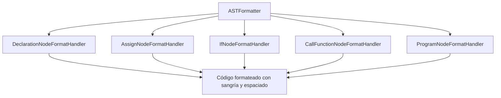

# Módulo `com.ingsis.formatter` y Composición Estructural de Nodos del AST

Este documento explica en detalle el funcionamiento del módulo [`com.ingsis.formatter`](file:///home/elchurro274/Faculty/ingsis/PrintScript/com.ingsis.formatter), las dos estrategias de formateo disponibles y la **composición exacta de cada nodo del Árbol de Sintaxis Abstracta (AST)** modelado en [`com.ingsis.common`](file:///home/elchurro274/Faculty/ingsis/PrintScript/com.ingsis.common).

---

## 1. Módulo `com.ingsis.formatter`: Propósito y Arquitectura

El módulo es responsable de tomar código fuente de PrintScript y transformarlo en una salida estéticamente estandarizada según reglas declaradas por el usuario (vía YAML) o reglas por defecto.

Dispone de dos arquitecturas complementarias:
1. **`TokenStreamFormatter` (Formateador Streaming por Tokens)**:
   - Utilizado por defecto en la CLI para máxima eficiencia de memoria.
   - Lee el flujo de tokens generado por el Lexer de forma perezosa (*lazy*), emitiendo cada token formateado al vuelo hacia un `Writer`.
   - Reconstruye y normaliza el espacio en blanco inter-token aplicando una cadena de reglas de formateo ([`FormattingRule`](file:///home/elchurro274/Faculty/ingsis/PrintScript/com.ingsis.formatter/src/main/java/formatter/rule/FormattingRule.java)).
2. **`ASTFormatter` (Formateador Estructural por AST / Visitor)**:
   - Recorre el árbol sintáctico estructurado (`ProgramNode` o cualquier subnodo).
   - Utiliza el patrón **Visitor** despachando a manejadores dedicados ([`FormatNodeHandler`](file:///home/elchurro274/Faculty/ingsis/PrintScript/com.ingsis.formatter/src/main/java/formatter/handler/FormatNodeHandler.java)) según la clase concreta de cada nodo.
   - Genera una representación canónica del código a partir del árbol puro.

---

## 2. Composición Detallada de los Nodos del AST

Todos los nodos del AST son **Java Records inmutables** ubicados en el módulo `com.ingsis.common` dentro del paquete `node`, implementando la interfaz base [`Node`](file:///home/elchurro274/Faculty/ingsis/PrintScript/com.ingsis.common/src/main/java/node/Node.java).

### 2.1. Interfaz Base: [`Node`](file:///home/elchurro274/Faculty/ingsis/PrintScript/com.ingsis.common/src/main/java/node/Node.java)
```java
public interface Node {
    Integer line();                      // Fila de inicio en el código fuente (1-based)
    Integer column();                    // Columna de inicio (1-based)
    String symbol();                     // Representación textual o keyword del nodo
    List<? extends Node> children();     // Nodos hijos para recorridos recursivos
    default <R, C> R accept(NodeVisitor<R, C> visitor, C context); // Doble despacho Visitor
}
```

---

### 2.2. Nodos de Nivel Programa y Bloque

#### [`ProgramNode`](file:///home/elchurro274/Faculty/ingsis/PrintScript/com.ingsis.common/src/main/java/node/ProgramNode.java)
Representa la raíz de un programa completo o script.
- **Definición**: `public record ProgramNode(List<Node> statements, Integer line, Integer column) implements Node`
- **Componentes**:
  - `statements`: Lista inmutable de sentencias del programa (`DeclarationKeywordNode`, `AssignNode`, `IfKeywordNode`, `CallFunctionNode`).
  - `line` / `column`: Coordenadas del inicio del archivo (generalmente 1, 1).
- **Hijos**: Devuelve la lista `statements`.

---

### 2.3. Nodos de Sentencias (*Statements*)

#### 1. [`DeclarationKeywordNode`](file:///home/elchurro274/Faculty/ingsis/PrintScript/com.ingsis.common/src/main/java/node/keyword/DeclarationKeywordNode.java)
Representa declaraciones de variables o constantes (`let` o `const`).
- **Definición**:
  ```java
  public record DeclarationKeywordNode(
      DeclarationType declarationType,     // LET o CONST
      IdentifierNode identifierNode,       // Nombre de la variable declarada
      ExpressionNode expressionNode,       // Valor inicial asignado o NilExpressionNode
      DataType declaredType,               // Tipo explícito: STRING, NUMBER, BOOLEAN
      Integer line,
      Integer column
  ) implements Node
  ```
- **Componentes**:
  - `declarationType`: Enum con `LET` (mutable) o `CONST` (inmutable en 1.1).
  - `identifierNode`: Nodo identificador que almacena el nombre.
  - `expressionNode`: Expresión a la derecha del signo `=`. Si se declara sin inicializar (`let a: number;`), contiene un [`NilExpressionNode`](file:///home/elchurro274/Faculty/ingsis/PrintScript/com.ingsis.common/src/main/java/node/expression/nullObject/NilExpressionNode.java).
  - `declaredType`: Tipo estático anotado en la firma (`DataType.STRING`, `DataType.NUMBER`, `DataType.BOOLEAN`).
- **Hijos**: `[identifierNode, expressionNode]`.

#### 2. [`AssignNode`](file:///home/elchurro274/Faculty/ingsis/PrintScript/com.ingsis.common/src/main/java/node/keyword/AssignNode.java)
Representa la reasignación de una variable existente (`x = 42;`).
- **Definición**:
  ```java
  public record AssignNode(
      IdentifierNode identifierNode,       // Variable destino
      ExpressionNode expressionNode,       // Nuevo valor a asignar
      Integer line,
      Integer column
  ) implements Node
  ```
- **Componentes**:
  - `identifierNode`: Identificador que recibe el nuevo valor.
  - `expressionNode`: Expresión computada que se evalúa y asigna.
- **Hijos**: `[identifierNode, expressionNode]`.

#### 3. [`IfKeywordNode`](file:///home/elchurro274/Faculty/ingsis/PrintScript/com.ingsis.common/src/main/java/node/keyword/IfKeywordNode.java)
Representa una estructura condicional `if (cond) { ... } else { ... }` (PrintScript 1.1).
- **Definición**:
  ```java
  public record IfKeywordNode(
      ExpressionNode condition,            // Expresión booleana condicional
      List<Node> thenBody,                 // Sentencias del bloque 'then'
      List<Node> elseBody,                 // Sentencias del bloque 'else' (vacía si no hay)
      Integer line,
      Integer column
  ) implements Node
  ```
- **Componentes**:
  - `condition`: Expresión que debe evaluarse a `boolean`.
  - `thenBody`: Lista inmutable de sentencias dentro de las llaves `{ ... }` del `if`.
  - `elseBody`: Lista inmutable de sentencias dentro del bloque `else` opcional.
- **Hijos**: `[condition, ...thenBody, ...elseBody]`.

---

### 2.4. Nodos de Expresión (*ExpressionNode*)

Todos los nodos evaluables implementan la interfaz sellada/marcador [`ExpressionNode`](file:///home/elchurro274/Faculty/ingsis/PrintScript/com.ingsis.common/src/main/java/node/expression/ExpressionNode.java):

#### 1. [`CallFunctionNode`](file:///home/elchurro274/Faculty/ingsis/PrintScript/com.ingsis.common/src/main/java/node/expression/function/CallFunctionNode.java)
Representa invocaciones a funciones del sistema (`println(...)`, `readInput(...)`, `readEnv(...)`).
- **Definición**:
  ```java
  public record CallFunctionNode(
      IdentifierNode identifierNode,       // Nombre de la función ("println", etc.)
      List<ExpressionNode> argumentNodes,  // Argumentos evaluables pasados a la función
      Integer line,
      Integer column
  ) implements ExpressionNode
  ```
- **Hijos**: `[identifierNode, ...argumentNodes]`.
- Puede actuar tanto como sentencia autónoma (`println(x);`) como parte de una expresión asignable (`let a: string = readInput("Prompt: ");`).

#### 2. [`OperatorNode`](file:///home/elchurro274/Faculty/ingsis/PrintScript/com.ingsis.common/src/main/java/node/expression/operator/OperatorNode.java)
Representa operaciones binarias en el árbol de expresiones.
- **Definición**:
  ```java
  public record OperatorNode(
      OperatorType operatorType,           // PLUS (+), MINUS (-), MULTIPLY (*), DIVIDE (/)
      ExpressionNode left,                 // Subárbol izquierdo
      ExpressionNode right,                // Subárbol derecho
      Integer line,
      Integer column
  ) implements ExpressionNode
  ```
- **Hijos**: `[left, right]`.

#### 3. Literales: [`LiteralNode<T>`](file:///home/elchurro274/Faculty/ingsis/PrintScript/com.ingsis.common/src/main/java/node/expression/LiteralNode.java)
Representan valores constantes directamente codificados en el código fuente. No tienen hijos:
- **[`NumberLiteralNode`](file:///home/elchurro274/Faculty/ingsis/PrintScript/com.ingsis.common/src/main/java/node/expression/literal/NumberLiteralNode.java)**:
  - Campo: `BigDecimal rawValue`. Soporta enteros y decimales de precisión arbitraria.
- **[`StringLiteralNode`](file:///home/elchurro274/Faculty/ingsis/PrintScript/com.ingsis.common/src/main/java/node/expression/literal/StringLiteralNode.java)**:
  - Campo: `String rawValue`. Almacena el valor deserializado sin las comillas envolventes.
- **[`BooleanLiteralNode`](file:///home/elchurro274/Faculty/ingsis/PrintScript/com.ingsis.common/src/main/java/node/expression/literal/BooleanLiteralNode.java)**:
  - Campo: `Boolean rawValue` (`true` o `false`).

#### 4. [`IdentifierNode`](file:///home/elchurro274/Faculty/ingsis/PrintScript/com.ingsis.common/src/main/java/node/expression/Identifier/IdentifierNode.java)
- Campo: `String name`. Nombre del identificador/variable que se referencia. No tiene hijos.

#### 5. [`NilExpressionNode`](file:///home/elchurro274/Faculty/ingsis/PrintScript/com.ingsis.common/src/main/java/node/expression/nullObject/NilExpressionNode.java)
- Objeto nulo (*Null Object Pattern*) utilizado para inicializaciones vacías (`let x: number;`).
- Línea y columna fijadas en `-1`.

---

## 3. Funcionamiento de los Motores de Formateo

### 3.1. Formateo por AST: `ASTFormatter` y sus Handlers

Cuando se formatea por AST, [`ASTFormatter`](file:///home/elchurro274/Faculty/ingsis/PrintScript/com.ingsis.formatter/src/main/java/formatter/ASTFormatter.java) implementa `NodeVisitor<String, FormatContext>` y delega cada nodo a su respectivo [`FormatNodeHandler`](file:///home/elchurro274/Faculty/ingsis/PrintScript/com.ingsis.formatter/src/main/java/formatter/handler/FormatNodeHandler.java):



- **[`DeclarationNodeFormatHandler`](file:///home/elchurro274/Faculty/ingsis/PrintScript/com.ingsis.formatter/src/main/java/formatter/handler/DeclarationNodeFormatHandler.java)**:
  - Genera `let` o `const`.
  - Evalúa `context.isSpaceBeforeColon()` y `context.isSpaceAfterColon()` para formatear `:`.
  - Si `expressionNode` no es `NilExpressionNode`, interpola `=` según `context.isSpaceAroundEquals()` y formatea recursivamente la expresión.
  - Finaliza con `;`.
- **[`AssignNodeFormatHandler`](file:///home/elchurro274/Faculty/ingsis/PrintScript/com.ingsis.formatter/src/main/java/formatter/handler/AssignNodeFormatHandler.java)**:
  - Genera `<indent><variable> = <expresión>;` respetando espacios alrededor del `=`.
- **[`IfNodeFormatHandler`](file:///home/elchurro274/Faculty/ingsis/PrintScript/com.ingsis.formatter/src/main/java/formatter/handler/IfNodeFormatHandler.java)**:
  - Escribe `if (<condición>)`.
  - Si `context.isIfBraceSameLine()`, coloca ` {\n`; si `context.isIfBraceBelowLine()`, salta de línea y alinea `{`.
  - Incrementa el nivel de sangría (`context.withIndentLevel(level + 1)`), formatea las sentencias del bloque `then` y cierra con `}`.
  - Si existe `elseBody`, coloca `} else {` o el formato configurado y formatea el cuerpo alternativo.
- **[`CallFunctionNodeFormatHandler`](file:///home/elchurro274/Faculty/ingsis/PrintScript/com.ingsis.formatter/src/main/java/formatter/handler/CallFunctionNodeFormatHandler.java)**:
  - Formatea la llamada `nombre(arg1, arg2);` intercalando `, ` o `,` según `context.isSpaceAfterComma()`.
  - Agrega saltos de línea tras `println` según `context.getLineBreaksAfterPrintln()`.

---

### 3.2. Formateo por Flujo de Tokens: `TokenStreamFormatter`

[`TokenStreamFormatter`](file:///home/elchurro274/Faculty/ingsis/PrintScript/com.ingsis.formatter/src/main/java/formatter/TokenStreamFormatter.java) procesa un `SafeIterator<Token>`. Para cada par de tokens adyacentes (`previousToken`, `currentToken`), ejecuta en secuencia la lista de reglas:

1. **[`SingleSpaceSeparationRule`](file:///home/elchurro274/Faculty/ingsis/PrintScript/com.ingsis.formatter/src/main/java/formatter/rule/SingleSpaceSeparationRule.java)**: Normaliza secuencias de espacios en blanco múltiples a un único espacio.
2. **[`SpaceBeforeColonRule`](file:///home/elchurro274/Faculty/ingsis/PrintScript/com.ingsis.formatter/src/main/java/formatter/rule/SpaceBeforeColonRule.java)**: Agrega o elimina el espacio previo al token `:` según configuración.
3. **[`SpaceAfterColonRule`](file:///home/elchurro274/Faculty/ingsis/PrintScript/com.ingsis.formatter/src/main/java/formatter/rule/SpaceAfterColonRule.java)**: Agrega o elimina el espacio posterior a `:`.
4. **[`SpaceAroundEqualsRule`](file:///home/elchurro274/Faculty/ingsis/PrintScript/com.ingsis.formatter/src/main/java/formatter/rule/SpaceAroundEqualsRule.java)**: Asegura espacios alrededor del operador `=`.
5. **[`SpaceAroundOperatorsRule`](file:///home/elchurro274/Faculty/ingsis/PrintScript/com.ingsis.formatter/src/main/java/formatter/rule/SpaceAroundOperatorsRule.java)**: Normaliza espacios alrededor de `+`, `-`, `*`, `/`.
6. **[`SpaceAfterCommaRule`](file:///home/elchurro274/Faculty/ingsis/PrintScript/com.ingsis.formatter/src/main/java/formatter/rule/SpaceAfterCommaRule.java)**: Controla el espacio tras las comas en llamadas a funciones.
7. **[`LineBreakAfterStatementRule`](file:///home/elchurro274/Faculty/ingsis/PrintScript/com.ingsis.formatter/src/main/java/formatter/rule/LineBreakAfterStatementRule.java)**: Inserta salto de línea tras cada punto y coma `;`.
8. **[`LinesBeforePrintlnRule`](file:///home/elchurro274/Faculty/ingsis/PrintScript/com.ingsis.formatter/src/main/java/formatter/rule/LinesBeforePrintlnRule.java)**: Inserta líneas vacías antes de invocaciones a `println`.
9. **[`BracePositionRule`](file:///home/elchurro274/Faculty/ingsis/PrintScript/com.ingsis.formatter/src/main/java/formatter/rule/BracePositionRule.java)** y **[`IndentationRule`](file:///home/elchurro274/Faculty/ingsis/PrintScript/com.ingsis.formatter/src/main/java/formatter/rule/IndentationRule.java)**: Gestionan la colocación de `{` y `}` y ajustan la sangría correspondiente.

---

## 4. Configuración YAML del Formateador

[`YamlFormatRulesLoader`](file:///home/elchurro274/Faculty/ingsis/PrintScript/com.ingsis.formatter/src/main/java/formatter/config/YamlFormatRulesLoader.java) mapea claves YAML al [`FormatContext`](file:///home/elchurro274/Faculty/ingsis/PrintScript/com.ingsis.formatter/src/main/java/formatter/FormatContext.java):

```yaml
spaceBeforeColon: true             # Espacio antes de ':' (let x : number)
spaceAfterColon: true              # Espacio después de ':' (let x: number)
spaceAroundAssignment: true        # Espacio alrededor de '=' (x = 5)
spaceAroundOperators: true         # Espacio alrededor de +, -, *, /
spaceAfterComma: true              # Espacio después de coma en llamadas
lineBreakAfterStatement: true      # Salto de línea luego de ';'
lineBreaksBeforePrintln: 1         # Líneas en blanco previas a println
lineBreaksAfterPrintln: 1          # Líneas en blanco posteriores a println
indentSize: 2                      # Cantidad de espacios por nivel de indentación
ifBraceSameLine: true              # if (...) { en la misma línea
ifBraceBelowLine: false            # { en línea nueva debajo del if
```
