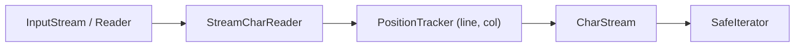
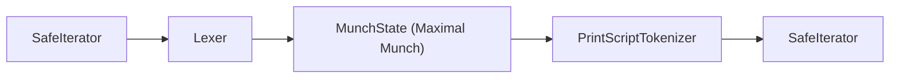
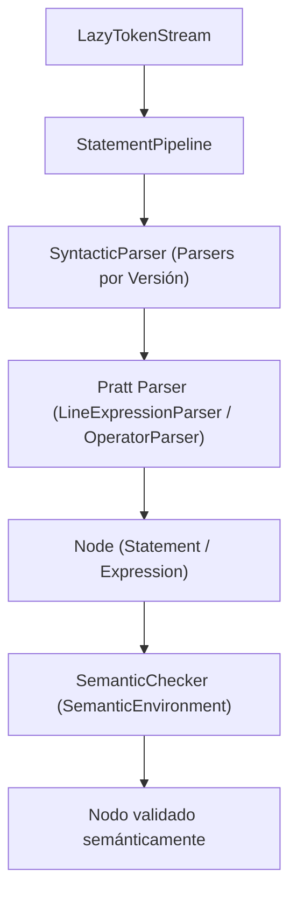
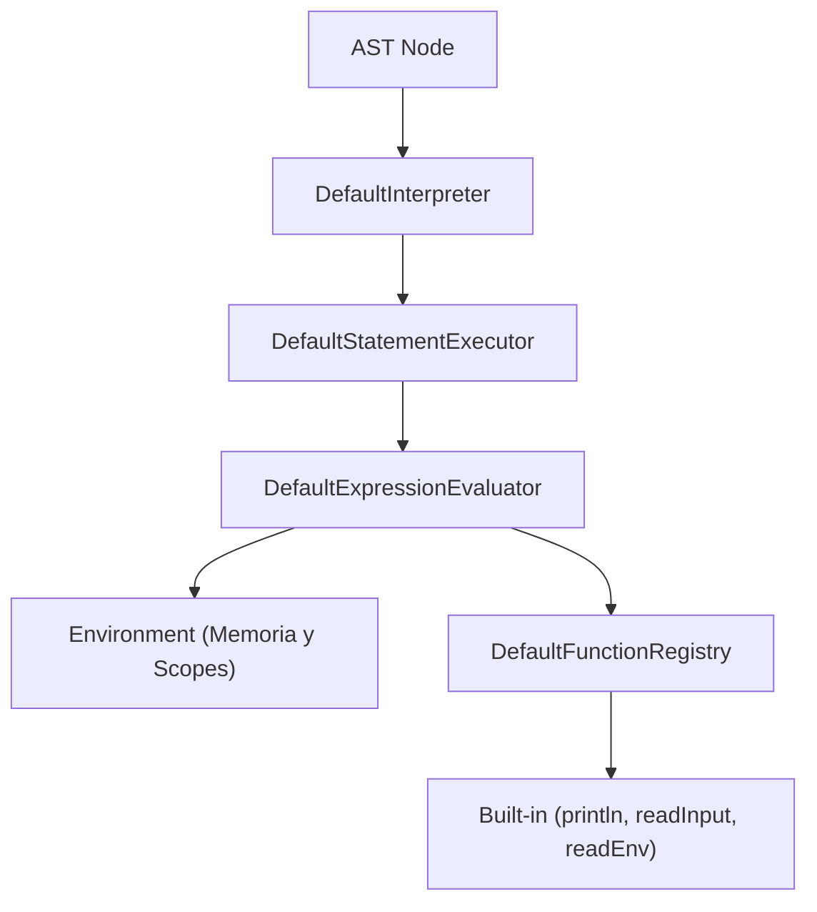
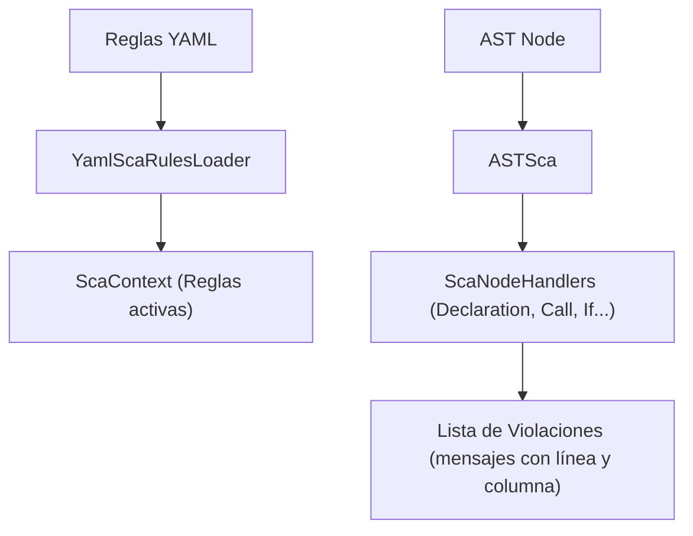

# Guía Técnica Exhaustiva de los Módulos de PrintScript: `common`, `charstream`, `lexer`, `parser`, `interpreter` y `sca`

Este documento describe la arquitectura, componentes, funcionamiento interno y patrones de diseño de todos los módulos restantes del compilador/intérprete **PrintScript**.

---

## 1. Módulo `com.ingsis.common`

Es el **módulo fundacional** de todo el ecosistema. Provee los tipos de dominio, contratos e infraestructuras de programación funcional sin dependencias de ningún otro módulo del proyecto.

### 1.1. Componentes Clave
- **Mónada de Resultado (`Result<T>`)**:
  - `CorrectResult<T>` y `IncorrectResult<T>`.
  - Reemplaza el uso de excepciones descontroladas y retornos `null`. Permite encadenamiento seguro de operaciones de compilación y ejecución.
- **Iterador Seguro (`SafeIterator<T>`)**:
  - `SafeIterator<T>` emite pasos de iteración tipados (`IterationStep<T>`).
  - Habilita el procesamiento perezoso (*lazy streaming*) de caracteres y tokens sin cargar archivos completos en memoria RAM.
- **Posicionamiento**:
  - [`Position`](file:///home/elchurro274/Faculty/ingsis/PrintScript/com.ingsis.common/src/main/java/position/Position.java): Inmutable `(line, column)`.
  - [`SourceRange`](file:///home/elchurro274/Faculty/ingsis/PrintScript/com.ingsis.common/src/main/java/position/SourceRange.java): Rango delimitado por una `startPosition` y una `endPosition` para reporte exacto de errores.
- **MetaCaracteres (`MetaCharacter`)**:
  - Encapsula un `char` primitivo junto con su coordenada `Position` en el archivo fuente.
- **Tokens y Matchers**:
  - [`Token`](file:///home/elchurro274/Faculty/ingsis/PrintScript/com.ingsis.common/src/main/java/token/Token.java): Representa un símbolo léxico con su `TokenType`, `SymbolType`, lexema `symbol` y `SourceRange`.
  - [`TokenTypeMatcher`](file:///home/elchurro274/Faculty/ingsis/PrintScript/com.ingsis.common/src/main/java/token/matcher/TokenTypeMatcher.java): Cadena de responsabilidad (*Chain of Responsibility*) que clasifica lexemas en palabras clave, operadores, literales booleanos, numéricos o cadenas, e identificadores.
- **Versión del Lenguaje**:
  - Enum [`Version`](file:///home/elchurro274/Faculty/ingsis/PrintScript/com.ingsis.common/src/main/java/version/Version.java): Define compatibilidad con `1.0` y `1.1`.

---

## 2. Módulo `com.ingsis.charstream`

Provee el flujo de caracteres enriquecidos (*streaming*) a partir de fuentes de entrada crudas (`InputStream` o `Reader`).

### 2.1. Componentes y Funcionamiento Interno
- **[`CharReader`](file:///home/elchurro274/Faculty/ingsis/PrintScript/com.ingsis.charstream/src/main/java/charstream/CharReader.java)**:
  - Contrato básico para leer el siguiente entero de carácter (`read()`) o cerrar el recurso (`close()`).
- **[`StreamCharReader`](file:///home/elchurro274/Faculty/ingsis/PrintScript/com.ingsis.charstream/src/main/java/charstream/StreamCharReader.java)**:
  - Lee bytes decodificando en UTF-8 y manejando adecuadamente el fin de archivo (`EOF = -1`).
- **[`PositionTracker`](file:///home/elchurro274/Faculty/ingsis/PrintScript/com.ingsis.charstream/src/main/java/charstream/PositionTracker.java)**:
  - Actualiza contadores de línea y columna en cada carácter consumido.
  - Reconoce saltos de línea Unix (`\n`) y Windows (`\r\n`), reiniciando la columna a 1 e incrementando la línea.
- **[`CharStream`](file:///home/elchurro274/Faculty/ingsis/PrintScript/com.ingsis.charstream/src/main/java/charstream/CharStream.java)**:
  - Expone la interfaz `SafeIterator<MetaCharacter>`.
  - Dispone de un mecanismo de **Pushback / Unget**: permite devolver caracteres leídos al flujo para retroceder en caso de lookahead de varios caracteres durante la tokenización.

---

## 3. Módulo `com.ingsis.lexer`

Es el analizador léxico (*scanner*) responsable de convertir el flujo de `MetaCharacter` en un flujo de `Token`.

### 3.1. Algoritmo y Funcionamiento Interno
- **Algoritmo Maximal Munch (Longest Match)**:
  - El tokenizador acumula caracteres de forma voraz mientras el lexema coincida potencialmente con un token válido más largo.
  - Por ejemplo: ante la secuencia `let `, consume `l`, `e`, `t` determinando que forma la palabra clave `let`, y corta antes del espacio en blanco.
  - Diferencia operadores compuestos de simples y maneja prefijos ambiguos.
- **Componentes**:
  - **[`Lexer`](file:///home/elchurro274/Faculty/ingsis/PrintScript/com.ingsis.lexer/src/main/java/lexer/Lexer.java)**: Implementa `SafeIterator<Token>` solicitando tokens al tokenizador a demanda.
  - **[`MunchState`](file:///home/elchurro274/Faculty/ingsis/PrintScript/com.ingsis.lexer/src/main/java/lexer/MunchState.java)**: Almacena el buffer de caracteres en evaluación y el último estado válido coincidente.
  - **[`PrintScriptTokenizer`](file:///home/elchurro274/Faculty/ingsis/PrintScript/com.ingsis.lexer/src/main/java/lexer/PrintScriptTokenizer.java)**: Utiliza la cadena de `TokenTypeMatcher` para categorizar cada lexema finalizado.
- **Soporte Léxico**:
  - Literales de texto con comillas dobles (`"hola"`) o simples (`'hola'`).
  - Literales numéricos enteros y de punto flotante (`10`, `3.14`).
  - Literales booleanos (`true`, `false`).
  - Palabras clave (`let`, `const`, `if`, `else`).
  - Identificadores de variables y funciones.
  - Símbolos de puntuación (`:`, `;`, `(`, `)`, `{`, `}`) y operadores (`+`, `-`, `*`, `/`, `=`).

---

## 4. Módulo `com.ingsis.parser`

Combina el **análisis sintáctico** (construcción de AST) y el **análisis semántico** (validación estática de tipos y alcances).

### 4.1. Análisis Sintáctico (Syntactic Parsing)
- **[`StatementPipeline`](file:///home/elchurro274/Faculty/ingsis/PrintScript/com.ingsis.parser/src/main/java/pipeline/StatementPipeline.java)**:
  - Procesa el archivo sentencia por sentencia sobre un [`LazyTokenStream`](file:///home/elchurro274/Faculty/ingsis/PrintScript/com.ingsis.parser/src/main/java/tokenstream/LazyTokenStream.java).
  - Al completar el parseo de una sentencia, la valida semánticamente de inmediato y ejecuta una acción opcional (ejecutarla en el intérprete o analizarla con el SCA).
- **Estrategias por Versión**:
  - `Version10Strategy`: Permite declaraciones `let`, llamadas a `println`, asignaciones y expresiones aritméticas/concatenación. Rechaza palabras clave como `const` o `if`.
  - `Version11Strategy`: Habilita `const`, bloques condicionales `if (...) { ... } else { ... }`, literales booleanos y llamadas a `readInput` y `readEnv`.
- **Parseo de Expresiones: Pratt Parsing (Top-Down Operator Precedence)**:
  - [`LineExpressionParser`](file:///home/elchurro274/Faculty/ingsis/PrintScript/com.ingsis.parser/src/main/java/syntactic/parser/root/LineExpressionParser.java) y [`OperatorParser`](file:///home/elchurro274/Faculty/ingsis/PrintScript/com.ingsis.parser/src/main/java/syntactic/parser/operator/OperatorParser.java).
  - Resuelve precedencia de operadores (`*` y `/` tienen mayor jerarquía que `+` y `-`) y asociatividad izquierda a derecha sin recursión infinita por izquierda.

### 4.2. Análisis Semántico (Semantic Checking)
- **[`SemanticChecker`](file:///home/elchurro274/Faculty/ingsis/PrintScript/com.ingsis.parser/src/main/java/semantic/SemanticChecker.java)**:
  - Utiliza el patrón Visitor/Handler (`DeclarationNodeSemanticHandler`, `AssignNodeSemanticHandler`, `IfNodeSemanticHandler`, `CallFunctionNodeSemanticHandler`).
- **[`SemanticEnvironment`](file:///home/elchurro274/Faculty/ingsis/PrintScript/com.ingsis.parser/src/main/java/semantic/environment/SemanticEnvironment.java)**:
  - Mantiene la tabla de símbolos durante el análisis estático.
  - Guarda para cada variable: nombre, tipo declarado (`DataType`), si es mutable (`let`) o inmutable (`const`), y si ya ha sido inicializada.
  - Soporta scopes jerárquicos (ámbitos locales dentro de bloques `if`/`else`).
- **[`ExpressionTypeInference`](file:///home/elchurro274/Faculty/ingsis/PrintScript/com.ingsis.parser/src/main/java/semantic/evaluator/ExpressionTypeInference.java)**:
  - Deduce el tipo resultante de cada expresión:
    - `NUMBER + NUMBER` $\rightarrow$ `NUMBER`
    - `STRING + ANY` o `ANY + STRING` $\rightarrow$ `STRING` (concatenación)
    - Operaciones `-`, `*`, `/` sobre tipos no numéricos $\rightarrow$ error semántico.
- **Validaciones Clave**:
  - Prohíbe el uso de variables no declaradas.
  - Prohíbe la reasignación de constantes (`const`).
  - Prohíbe asignaciones entre tipos incompatibles (ej. asignar `STRING` a variable `NUMBER`).
  - Exige que la condición de un `if` sea de tipo `BOOLEAN`.
  - Valida disponibilidad y número de argumentos de funciones built-in según versión.

---

## 5. Módulo `com.ingsis.interpreter`

Es el motor de ejecución en tiempo de ejecución (*runtime*) que evalúa las sentencias validadas y actualiza el estado de la memoria.

### 5.1. Componentes y Funcionamiento Interno
- **[`DefaultInterpreter`](file:///home/elchurro274/Faculty/ingsis/PrintScript/com.ingsis.interpreter/src/main/java/interpreter/DefaultInterpreter.java)**:
  - Punto de entrada del intérprete. Conecta el parser, el chequeador semántico y el ejecutor de sentencias.
- **[`DefaultStatementExecutor`](file:///home/elchurro274/Faculty/ingsis/PrintScript/com.ingsis.interpreter/src/main/java/executor/DefaultStatementExecutor.java)**:
  - Ejecuta cada sentencia modificando el [`Environment`](file:///home/elchurro274/Faculty/ingsis/PrintScript/com.ingsis.interpreter/src/main/java/environment/Environment.java):
    - Declaración: registra la variable con su valor inicial evaluado.
    - Asignación: actualiza el valor en el entorno correspondiente.
    - Condicional `if`: evalúa la condición booleana y ejecuta el bloque `thenBody` o `elseBody` creando un **sub-entorno hijo** para aislamiento de scope.
    - Llamada: evalúa la función (como `println`).
- **[`DefaultExpressionEvaluator`](file:///home/elchurro274/Faculty/ingsis/PrintScript/com.ingsis.interpreter/src/main/java/evaluator/DefaultExpressionEvaluator.java)**:
  - Evalúa recursivamente el árbol de expresiones:
    - Literales numéricos $\rightarrow$ `BigDecimal`.
    - Literales string $\rightarrow$ `String`.
    - Literales booleanos $\rightarrow$ `Boolean`.
    - Identificadores $\rightarrow$ busca el valor en el `Environment` actual o en sus padres.
    - Operadores: ejecuta suma/concatenación, resta, multiplicación y división con validación de **división por cero**.
- **Entorno de Runtime ([`Environment`](file:///home/elchurro274/Faculty/ingsis/PrintScript/com.ingsis.interpreter/src/main/java/environment/Environment.java))**:
  - Almacena el mapa de valores en memoria.
  - Dispone de referencia a un entorno padre (`parent`), permitiendo que variables del bloque interno oculten o accedan a variables del bloque externo, y que las variables declaradas dentro de un `if` mueran al salir de su bloque.
- **Registro de Funciones Nativas ([`DefaultFunctionRegistry`](file:///home/elchurro274/Faculty/ingsis/PrintScript/com.ingsis.interpreter/src/main/java/builtin/DefaultFunctionRegistry.java))**:
  - `println`: Convierte el valor a texto y lo entrega al `OutputEmitter`.
  - `readInput`: Emite un prompt, lee una línea del `InputSupplier` y la parsea dinámicamente al tipo requerido (`string`, `number`, `boolean`). Lanza error si la conversión falla.
  - `readEnv`: Consulta la variable de entorno solicitada mediante el proveedor (`System::getenv`).

---

## 6. Módulo `com.ingsis.sca`

Es el analizador estático de código (*Static Code Analyzer / Linter*) que detecta violaciones de estilo y buenas prácticas sin necesidad de compilar ni ejecutar.

### 6.1. Componentes y Reglas Verificadas
- **[`ASTSca`](file:///home/elchurro274/Faculty/ingsis/PrintScript/com.ingsis.sca/src/main/java/sca/ASTSca.java)**:
  - Recorre los nodos del AST aplicando los handlers correspondientes ([`DeclarationScaHandler`](file:///home/elchurro274/Faculty/ingsis/PrintScript/com.ingsis.sca/src/main/java/sca/handler/DeclarationScaHandler.java), [`CallFunctionScaHandler`](file:///home/elchurro274/Faculty/ingsis/PrintScript/com.ingsis.sca/src/main/java/sca/handler/CallFunctionScaHandler.java), [`IfScaHandler`](file:///home/elchurro274/Faculty/ingsis/PrintScript/com.ingsis.sca/src/main/java/sca/handler/IfScaHandler.java)).
- **[`YamlScaRulesLoader`](file:///home/elchurro274/Faculty/ingsis/PrintScript/com.ingsis.sca/src/main/java/sca/config/YamlScaRulesLoader.java)** y **[`ScaContext`](file:///home/elchurro274/Faculty/ingsis/PrintScript/com.ingsis.sca/src/main/java/sca/ScaContext.java)**:
  - Carga y valida el archivo de reglas YAML.
- **Reglas Implementadas**:
  1. **`identifier_format`**:
     - `camel case`: Exige que los identificadores inicien en minúscula y no contengan guiones bajos (ej. `miVariable`).
     - `snake case`: Exige que los identificadores utilicen minúsculas separadas por guión bajo (ej. `mi_variable`).
  2. **`mandatory-variable-or-literal-in-println`**:
     - Si está activa (`true`), prohíbe pasar expresiones computadas como argumento directo de `println(a + b);`. Exige que se asigne primero a una variable o que sea un literal directo.
  3. **`mandatory-variable-or-literal-in-readInput`**:
     - Si está activa (`true`), exige que el prompt pasado a `readInput(...)` sea un literal o variable, no una expresión compuesta.
